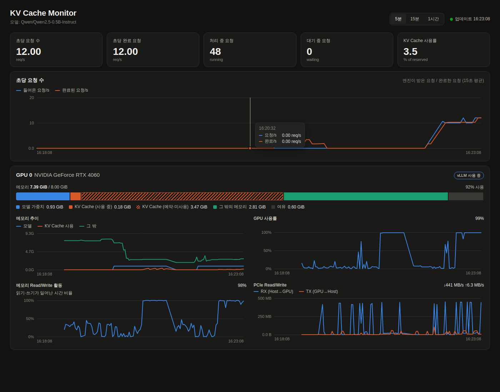

# KV Cache Monitor

vLLM으로 LLM을 서빙하는 동안 탐지되는 **모든 GPU**에 대해 아래 항목을 실시간으로 보여주는 대시보드입니다.

- **메모리 구성**: 모델 가중치 / KV Cache (사용 중 · 예약됐지만 미사용) / 그 밖의 메모리 / 여유
- **요청 수**: 초당 들어온 요청, 초당 완료 요청, 처리 중·대기 중 요청
- **GPU 사용률**
- **GPU Read/Write**: 메모리 읽기·쓰기 활동(%)과 PCIe RX/TX 처리량



## 구성

```
browser ──:8080──▶ frontend (nginx, 정적 대시보드)
                      │  /api/* → prometheus 프록시
                      ▼
               prometheus :9090  ──2초마다 scrape──▶  serving (config/servers.yml의 서버마다)
                                                       ├─ vLLM OpenAI 서버 :8000 (/v1, /metrics)
                                                       └─ GPU exporter     :9400 (/metrics)
```

| 컨테이너 | 폴더 | 역할 | 포트 |
|---|---|---|---|
| `frontend` | `./frontend` | nginx로 대시보드(HTML/JS) 제공, `/api/*`를 Prometheus로 프록시 | 8080 |
| `serving` | `./serving` | vLLM 서버 + GPU 메모리 exporter | 8000 (vLLM 기본), 9400 (내부) |
| `prometheus` | `./prometheus` | 두 `/metrics`를 2초 간격으로 수집, 7일 보관 | 9090 |

## 요구사항

- NVIDIA GPU + 드라이버
- Docker, Docker Compose v2
- [NVIDIA Container Toolkit](https://docs.nvidia.com/datacenter/cloud-native/container-toolkit/) (컨테이너에서 GPU 사용)
- `vllm/vllm-openai:v0.33.0` 이미지 (없으면 빌드 시 자동으로 받음, 약 35GB)

## 실행

```bash
cp .env.example .env          # 모델, TP 크기, 포트 등 수정
docker compose up -d --build
docker logs -f kvmon-serving  # "Application startup complete." 가 나오면 준비 완료
```

| 서비스 | 주소 |
|---|---|
| 대시보드 | http://localhost:8080 |
| vLLM API | http://localhost:8000/v1 |
| Prometheus | http://localhost:9090 |

종료:

```bash
docker compose down           # 모델 캐시(hf-cache)와 Prometheus 데이터는 볼륨에 남음
docker compose down -v        # 볼륨까지 삭제
```

### 환경 변수 (`.env`)

| 변수 | 기본값 | 설명 |
|---|---|---|
| `MODEL` | `Qwen/Qwen2.5-0.5B-Instruct` | 서빙할 HF 모델 |
| `TENSOR_PARALLEL_SIZE` | `1` | 예: GPU 4개에 모델을 나누려면 `4` |
| `PIPELINE_PARALLEL_SIZE` | `1` | |
| `GPU_MEMORY_UTILIZATION` | `0.85` | vLLM이 쓸 GPU 메모리 비율. 다른 프로세스가 GPU를 쓰고 있으면 낮추세요 |
| `MAX_MODEL_LEN` | `4096` | |
| `VLLM_EXTRA_ARGS` | | `vllm serve`에 그대로 붙는 추가 인자 |
| `HF_TOKEN` | | gated 모델용 |
| `VLLM_HOST_PORT` | `8000` | 호스트 쪽 포트 (컨테이너 내부 포트는 고정) |
| `EXPORTER_HOST_PORT` | `9400` | GPU exporter 호스트 쪽 포트 (다른 호스트의 Prometheus가 가져갈 때) |
| `FRONTEND_HOST_PORT` | `8080` | |
| `PROMETHEUS_HOST_PORT` | `9090` | |

vLLM 버전은 `serving/Dockerfile`의 `VLLM_IMAGE` 인자로 바꿉니다.

### 여러 vLLM 서버 모니터링 (`config/servers.yml`)

대시보드 왼쪽 위의 선택 상자에서 볼 서버를 고릅니다. 처음에는 아무것도 선택되어 있지 않습니다. 목록은 `config/servers.yml`(Prometheus `file_sd` 형식)에 적습니다.

```yaml
- targets: ["serving:8000"]          # 이 compose의 serving 컨테이너
  labels:
    server: local
- targets: ["192.168.10.10:5000"]    # vLLM 주소 (host:port)
  labels:
    server: A                        # 선택 상자에 보일 이름 (생략하면 주소)
- targets: ["192.168.20.10:5000"]
  labels:
    server: B
    __exporter: "192.168.20.10:9500" # exporter 주소. 생략하면 같은 host의 9400
```

- 다른 호스트에서는 `serving` 컨테이너만 띄우면 됩니다: `docker compose up -d serving` (`.env`의 `VLLM_HOST_PORT`, `EXPORTER_HOST_PORT`로 포트 지정).
- 파일을 저장하면 Prometheus가 바로 다시 읽습니다. 재시작할 필요가 없습니다.
- 모든 지표에 `server` 레이블이 붙고, 대시보드는 고른 서버의 지표만 조회합니다. 선택 상자에는 이름, 주소, 서빙 중인 모델(응답이 없으면 "응답 없음")이 나옵니다.
- 선택한 서버는 URL(`#server=A`)에 남으므로 새로고침하거나 링크를 공유해도 유지됩니다.

## 대시보드

2초마다 갱신되고, 오른쪽 위에서 시간 범위(5분 / 15분 / 1시간)를 고릅니다. 그래프에 마우스를 올리면 그 시점의 값이 나옵니다.

**상단 (전체)**
- 초당 요청 수, 초당 완료 요청, 처리 중 요청, 대기 중 요청, KV Cache 사용률
- 초당 요청 수 그래프 (들어온 요청 / 완료된 요청)

**GPU별 카드** — 탐지된 GPU 수만큼 생깁니다.
- 메모리 막대: 모델 가중치 · KV Cache 사용 중 · KV Cache 예약·미사용(빗금) · 그 밖 · 여유
- 메모리 추이: 모델 / KV Cache 사용 / 그 밖 (GiB)
- GPU 사용률 (%)
- 메모리 Read/Write 활동 (%)
- PCIe Read/Write: RX(Host→GPU) / TX(GPU→Host)
- vLLM이 쓰는 GPU에는 "vLLM 사용 중", 아닌 GPU에는 "vLLM 미할당" 표시

## 부하 테스트 (`bench.sh`)

실행 중인 `kvmon-serving` 컨테이너 안에서 `vllm bench serve`를 랜덤 프롬프트로 돌립니다. 도는 동안 대시보드에서 요청 수와 KV Cache가 변하는 걸 볼 수 있습니다. 컨테이너 안에서 8000번으로 직접 요청하므로 호스트 포트 설정과 상관없이 동작합니다.

```bash
./bench.sh                                                   # 기본값으로 실행
NUM_PROMPTS=500 REQUEST_RATE=inf MAX_CONCURRENCY=64 ./bench.sh
INPUT_LEN=2048 OUTPUT_LEN=1024 ./bench.sh --ignore-eos       # 뒤 인자는 vllm bench serve로 그대로 전달
```

| 변수 | 기본값 | 설명 |
|---|---|---|
| `NUM_PROMPTS` | `200` | 보낼 요청 수 |
| `REQUEST_RATE` | `10` | 초당 요청 수 (`inf`면 한 번에 모두) |
| `MAX_CONCURRENCY` | `32` | 최대 동시 요청 수 |
| `INPUT_LEN` | `512` | 입력 토큰 수 |
| `OUTPUT_LEN` | `256` | 출력 토큰 수 |

모델 이름은 `.env`의 `MODEL`을 씁니다. 끝나면 처리량, TTFT, TPOT, ITL 요약이 출력됩니다.

## 지표 계산 방법

`serving` 컨테이너에서 `entrypoint.sh`가 vLLM 출력을 `/var/log/vllm/vllm.log`에도 기록하고, `exporter.py`가 1초마다 이 로그와 NVML, vLLM `/metrics`를 읽어 값을 갱신합니다.

| 대시보드 항목 | 출처 |
|---|---|
| 모델 가중치 메모리 | vLLM 로그 `Model loading took X GiB` (rank별) |
| KV Cache 예약 메모리 | vLLM 로그 `Available KV cache memory: X GiB` (rank별) |
| KV Cache 사용 중 | 예약 메모리 × `vllm:kv_cache_usage_perc` |
| 그 밖의 메모리 | NVML 사용 메모리 − 모델 − KV 예약 |
| GPU 사용률 | NVML `utilization.gpu` |
| 메모리 Read/Write 활동 | NVML `utilization.memory` (메모리 읽기·쓰기가 일어난 시간 비율) |
| PCIe Read/Write | NVML PCIe RX/TX 처리량 |
| 초당 들어온 요청 | `rate(kvmon_vllm_requests_received_total[15s])` |
| 초당 완료 요청 | `rate(vllm:request_success_total[15s])` |
| 처리 중 / 대기 중 요청 | `vllm:num_requests_running` / `vllm:num_requests_waiting` |

참고:

- **그 밖의 메모리**에는 CUDA context, CUDA graph, activation 버퍼, 그리고 **같은 GPU를 쓰는 다른 프로세스**의 메모리가 들어갑니다.
- **초당 들어온 요청**: vLLM에는 요청이 *도착할 때* 올라가는 카운터가 없습니다 (`http_*`, `request_success`는 요청이 끝날 때 집계). 그래서 exporter가 `완료(모든 사유) + 처리 중 + 대기 중`을 누적 카운터로 내보내고, 그 증가율을 도착률로 씁니다. 요청은 사라지지 않으므로 이 값은 엔진이 받은 요청 수와 같습니다. 토큰화 중인 아주 짧은 순간의 요청은 빠집니다.
- **GPU ↔ rank 매핑**: `CUDA_DEVICE_ORDER=PCI_BUS_ID`로 NVML과 CUDA의 GPU 번호를 맞추고, vLLM이 앞에서부터 `TP × PP`개의 GPU를 쓴다고 가정합니다. 나머지 GPU의 사용 메모리는 모두 "그 밖"으로 잡힙니다.
- rank별 로그가 rank 0에서만 찍히는 vLLM 버전에서는 GPU마다 나눠 담긴 양이 같으므로 rank 0 값을 다른 GPU에도 씁니다.
- vLLM이 재시작되면 로그 파일이 새로 만들어지고, exporter도 값을 처음부터 다시 읽습니다.

### exporter 지표 (`serving:9400/metrics`)

| 지표 | 설명 |
|---|---|
| `kvmon_gpu_memory_total_bytes` | 전체 GPU 메모리 |
| `kvmon_gpu_memory_used_bytes` | 사용 중인 GPU 메모리 |
| `kvmon_gpu_memory_model_bytes` | 모델 가중치 |
| `kvmon_gpu_memory_kv_cache_allocated_bytes` | KV Cache 예약 |
| `kvmon_gpu_memory_kv_cache_used_bytes` | KV Cache 사용 중 |
| `kvmon_gpu_memory_other_bytes` | 그 밖의 메모리 |
| `kvmon_gpu_utilization_percent` | GPU 사용률 |
| `kvmon_gpu_memory_rw_utilization_percent` | 메모리 Read/Write 활동 |
| `kvmon_gpu_pcie_rx_bytes_per_second` / `..._tx_...` | PCIe 처리량 |
| `kvmon_gpu_vllm_assigned` | vLLM이 쓰는 GPU면 1 |
| `kvmon_vllm_requests_received_total` | 엔진이 받은 누적 요청 수 (GPU 레이블 없음) |

`kvmon_gpu_*`는 모두 `gpu`(번호), `name`, `uuid` 레이블이 붙습니다.

## 문제 해결

| 증상 | 해결 |
|---|---|
| `Bind for ...:8000 failed: port is already allocated` | `.env`에서 `VLLM_HOST_PORT` 등 호스트 포트를 바꾸기 |
| `Free memory on device ... is less than desired GPU memory utilization` | 다른 프로세스가 GPU를 쓰는 중. `GPU_MEMORY_UTILIZATION`을 낮추기 |
| 대시보드에 "GPU 지표가 아직 없습니다" | `docker logs kvmon-serving`에서 `[exporter] N GPU(s) detected`가 찍혔는지, Prometheus Targets(http://localhost:9090/targets)가 UP인지 확인 |
| 모델·KV Cache가 0으로 나옴 | vLLM이 아직 모델을 올리는 중이거나 실패함. `docker logs kvmon-serving`에서 `Model loading took` 줄 확인 |
| PCIe가 "미지원" | 이 환경(예: WSL2)의 NVML이 PCIe 처리량을 지원하지 않음. 다른 항목은 정상 동작 |
| 선택 상자에 서버가 "응답 없음" | 그 호스트에서 vLLM이 떠 있는지, Prometheus 컨테이너에서 그 주소로 접근되는지(방화벽) 확인 |
| `bench.sh` 실행 시 `No such container` | 먼저 `docker compose up -d`로 스택을 띄우기 |

## 파일 구조

```
.
├── docker-compose.yml
├── .env.example
├── bench.sh                 # vllm bench serve 부하 테스트
├── config/
│   └── servers.yml          # 모니터링할 vLLM 서버 목록
├── frontend/
│   ├── Dockerfile           # nginx:alpine
│   ├── nginx.conf           # :8080, /api/* → prometheus:9090
│   └── html/                # index.html, app.js, style.css (외부 라이브러리 없음)
├── serving/
│   ├── Dockerfile           # vllm/vllm-openai + nvidia-ml-py, prometheus_client
│   ├── entrypoint.sh        # exporter 백그라운드 실행 + vllm serve (로그 tee)
│   └── exporter.py          # GPU 메모리 구성 / 사용률 / Read/Write exporter
├── prometheus/
│   ├── Dockerfile
│   └── prometheus.yml       # scrape 2s: servers.yml의 vLLM(/metrics) + exporter(:9400)
└── docs/
    └── dashboard.png
```
